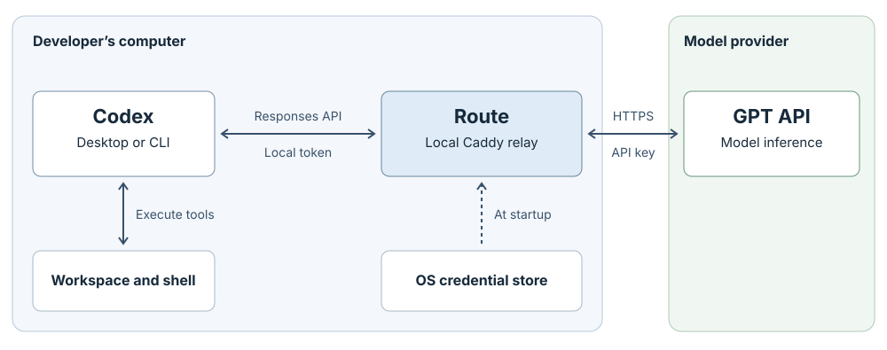
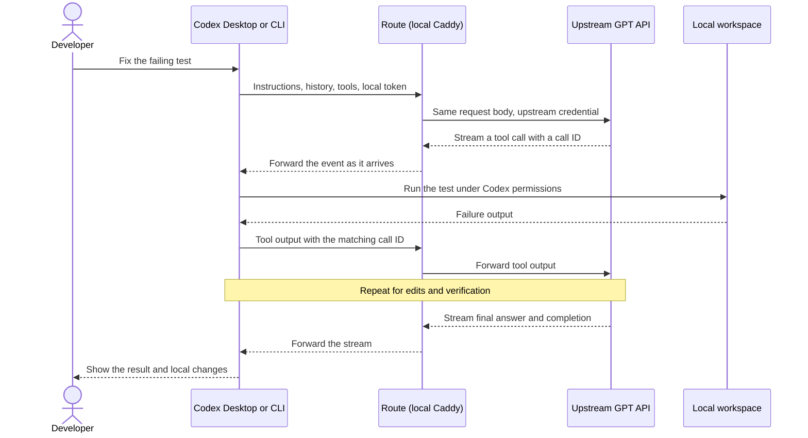

# Route for Codex

Route connects a developer's local Codex Desktop and CLI sessions to OpenAI using the developer’s API project key. Coding and image generation must both work in a fresh Codex profile with no ChatGPT sign-in. Coding uses the Responses API. Image generation uses a local tool backed by the Images API. Each developer runs one relay on their own macOS, Windows, or Linux machine.

During setup and key replacement, Route intersects the current key’s OpenAI model list with GPT‑6-or-later entries known to support Codex streaming and tool calls. Route supplies Desktop and CLI with a catalog for their Codex version, including each model’s reasoning efforts. Caddy forwards the selected model ID and effort on inference requests. GPT‑6.2 Sol and GPT‑6.2 Astra remain the end-to-end reference models for v1. [OpenAI model list](https://developers.openai.com/api/reference/resources/models/methods/list) · [Codex gateway catalogs](https://learn.chatgpt.com/docs/enterprise/roll-out-a-gateway#implement-the-catalog-endpoint)

Preserve an existing eligible model and supported effort. Otherwise the first-session default is GPT‑6.2 Sol at `medium` when available. If it is unavailable, ask the developer to choose from the eligible models.

Access to one eligible model is sufficient. If OpenAI rejects the selected model for this API project, Route surfaces the error. The developer can choose another eligible model and retry. [OpenAI project model permissions](https://help.openai.com/en/articles/9186755-managing-projects-in-the-api-platform)

## Combined picker under development

The next release uses one combined provider for new chats. Selecting an ordinary row keeps native billing. A row such as **Route 6.2 Sol** selects the project key. Both groups stay in the picker when the default row changes. The gateway receives separate native and local credentials. A Go dispatcher behind Caddy chooses the destination on each request and translates Route aliases to upstream model IDs. Built-in image requests use the originating turn to select the same billing account. See the [stock-client proof](docs/combined-picker-proof.md) and [implementation tickets](.scratch/combined-picker/issues/).

## Current single-provider setup

**Test connection** checks only the selected model. The first request through the relay asks the model to call a setup tool. When called, the tool generates a fresh random value in memory. A second request returns that value under the matching tool-call ID. Setup succeeds when the final streamed reply contains the exact value. The check takes two inference requests and requires no project files or shell commands.

Run the full check during initial setup, when the API key changes, or when the developer selects **Test connection**. Manual and automatic reconnects with the same saved key skip the check. If access has changed, Route surfaces the upstream error on the next request.

Replacing the API key takes effect immediately for every new upstream request from Desktop and CLI, including the connection test and follow-up tool results. If the test fails, Route shows the error and keeps the replacement key active. It never retries with the previous key.

A response already streaming under the previous key can finish. New requests use the replacement key immediately, even while that stream is open.

If the upstream connection drops mid-response, Route propagates the interruption to Codex. Any retry must originate from Codex or the developer. The release check drops the upstream stream after Route forwards a tool call and verifies that Codex can detect the interruption and Route sends no replay request.

When a developer presses **Stop** in Codex, Route immediately closes that request’s upstream stream. Verify cancellation from both Desktop and CLI by checking that a streaming test provider observes the disconnect before it finishes generating.

1. On Mac or Windows the developer runs the terminal installer. It installs the CLI and calls `route-for-codex onboard` to prompt for a project key, verify it and select the default provider. The native application also offers **Connect to Codex**. Both entry points use the preset endpoint.
2. Setup saves the upstream API key for this endpoint in the developer’s local OS credential store. If secure storage is unavailable, setup offers session-only use and holds the key in memory for that connection. Route keeps credentials out of config files and logs. It generates a separate random local token and starts bundled Caddy as a per-user background service on loopback.
3. Setup registers the `route` provider and `route_images` stdio MCP server in the shared Codex configuration. Both launch using absolute executable paths. A credential helper returns the local token to either client, including Desktop launched outside a terminal. After **Test connection** succeeds, setup offers **Use Route by default**. Selecting it sets Route as the provider for new local sessions in both Codex Desktop and CLI. [Codex shared configuration](https://learn.chatgpt.com/docs/models?surface=app) · [Credential helpers](https://learn.chatgpt.com/docs/config-file/config-advanced#custom-model-providers)

**Disconnect** stops the relay, invalidates the local token, and retains the securely saved upstream API key. When a saved key exists, Route shows “Disconnected. Your API key is saved on this device.” The available actions are **Reconnect** and **Forget API key**. In session-only mode, disconnecting discards the in-memory key.

Disconnect restores Codex settings individually. For each setting Route changed, it records the previous value (including whether the setting was absent) and the value it wrote. If the current value still matches what Route wrote, Disconnect restores the previous value or removes the setting if it was originally absent. Later developer edits take precedence. For example, Disconnect can restore the previous provider while keeping a developer’s subsequent switch from Sol to Astra.

**Reconnect** retrieves the saved API key and generates a fresh local token. A developer who used session-only mode enters their API key again.

At login after a restart, Route reconnects automatically if the developer left it connected with a saved key. An explicit Disconnect persists across restarts, even while the key is saved. A session-only connection ends at restart and requires the developer to enter the key again.

If the credential store is locked when automatic reconnect is due, Route shows **Waiting for unlock** and waits quietly at login. If the store is still locked when the developer next uses Route, offer the OS unlock prompt. After unlock, reconnect with the saved key.

**Forget API key** disconnects an active relay and deletes Route’s saved copy from this device. The upstream key remains valid at OpenAI.

## Image generation with a project key

Codex invokes `mcp__route_images__generate_image` with a prompt. The MCP server sends one authenticated `POST /v1/images/generations` to the same loopback relay used for coding. Caddy supplies the current project key. The server requests one PNG from `gpt-image-2`, validates the decoded image, and atomically saves it under `~/.route/images/` (or `ROUTE_HOME/images/`). It returns the absolute file path. Codex copies the PNG into the workspace under its usual file permissions and references the copy from HTML.

The request deadline is 240 seconds and the Codex tool timeout is 270 seconds. An MCP cancellation closes the upstream request. A timeout or cancellation can arrive after OpenAI started generation, so Route never automatically replays it. The optional combined picker's built-in image tool has a separate qualification record. [API-key-only results and repeatable check](docs/api-key-only-images.md)

## A coding task in flight

Caddy accepts a local bearer token, forwards the request to the configured HTTPS origin with its upstream credential, and streams the reply. The GPT model chooses the actions. Codex applies its approval and sandbox settings to local execution. The upstream receives the conversation and any file excerpts or tool output Codex sends. The design requires no Route-operated cloud service. [Codex agent loop](https://openai.com/index/unrolling-the-codex-agent-loop/) · [Caddy streaming behavior](https://caddyserver.com/docs/caddyfile/directives/reverse_proxy#streaming)

## Development and release

The combined picker ships in one coordinated release. Both stock clients must pass on macOS, Windows and graphical Debian 13, including same-chat switching, built-in image generation and the local latency target. Record each of the six results before publishing.

| Stage | Deliverable | Acceptance check |
| --- | --- | --- |
| 1. Verify the relay | Bundle Caddy with a fixed upstream, local authentication, and a Responses route. Preserve the request body, streaming events, status codes, and tool-call IDs. | Run a real Codex CLI session against a deterministic test provider through the bundled Caddy. Read a random value from disk, edit a fixture, run its test, then ask a follow-up that needs the earlier result. Reject an invalid local token before contacting the provider. |
| 2. Package the connection | Implement Connect, Test connection, Disconnect, Reconnect, and Forget API key for Desktop and terminal users. | On macOS, Windows, and Linux, verify Desktop from its normal launcher and CLI from a new terminal. Repeat after a restart and key rotation. Check settings restoration, rejection of the old local token after reconnect, and local key deletion after Forget. With secure storage unavailable, confirm session-only use prompts for the key again after disconnect. |
| 3. Qualify the real endpoint | Exercise the target GPT model, reasoning settings, context limits, streaming, file edits, and supported tools. Expose local status and distinguish a stopped relay, rejected key, rate limit, and interrupted stream. Keep credentials, request bodies, and tool output out of diagnostic logs by default. | Cancel a running turn and interrupt a stream. Check that Route does not resubmit a partially completed turn. Compare matched direct API and relayed requests for time to first event and total duration. Run the file-edit-and-test workflow from both clients. |

**Image generation with only a project key is required for v1.** With Codex signed out, run the same task through the Route image tool in Desktop and CLI, each in a fresh workspace. Each run passes when the generated image exists in the workspace and the rendered page displays that image. Both clients must pass before release.

**Relay latency is a v1 release requirement.** Send matched pairs of identical requests from the same client to a deterministic local streaming provider, one directly and one through Route. For each request, time from sending the request until the client receives the first complete stream event. For each pair, subtract the direct time from the relayed time. The 95th percentile of those differences must be at most 50 ms.

## Current evidence

The signed-out macOS Codex CLI generated images with the saved Route key on both Sol and Astra. Each workspace PNG matched the Route artifact and appeared on its rendered page. Desktop and cross-platform image checks remain open. See the [qualification record](docs/qualification.md) for versions, commands, and outstanding gates.
